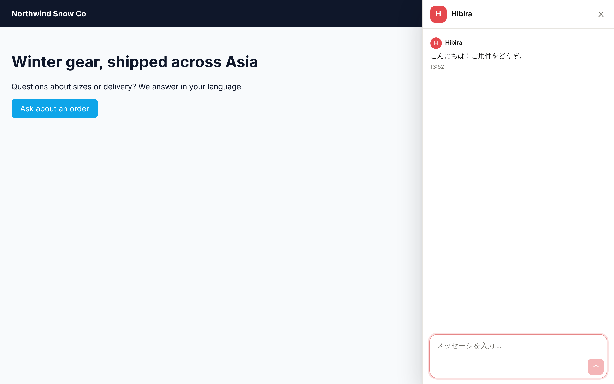

# Hibira Live Chat for Bubble

A live chat bubble for [Bubble](https://bubble.io) apps, connected to
[Hibira Live Chat](https://chat.hibira.io/?utm_source=github&utm_medium=readme&utm_campaign=bubble-live-chat):
AI answers from your help articles, translation both ways (English, Chinese, Japanese, Korean, Thai, Vietnamese),
one inbox for your team and verified signed-in users. A separate plugin from
[Hibira Realtime](https://github.com/hibira-io/bubble), which is for builders who need live events and presence.



## Setup

1. Create a free account at [chat.hibira.io](https://chat.hibira.io).
2. In **Settings › Widget** there, copy the **Workspace ID** (`ws_…`) and add your Bubble domains to the sites,
   such as `https://yourapp.bubbleapps.io` and your custom domain. The chat shows only on listed sites.
3. In Bubble, install **Hibira Live Chat**, then paste the Workspace ID on the Plugins tab.
4. Drop a **Hibira Live Chat** element on each page that should have the chat (a reusable header works). It draws
   nothing; the chat button appears in the corner.

| Field | What it does |
| --- | --- |
| Show chat button | The round button in the corner. Off: open the chat only from your own buttons. |
| Colour | Optional, such as `#e5484d`. Empty uses the colour set on chat.hibira.io. |
| Language | Optional: `en`, `zh-TW`, `zh-CN`, `ja`, `ko`, `th`, `vi`. Empty follows the visitor's browser. |

**States:** Ready, Error. **Events:** the chat is ready, an error occurs.

**Element actions:** Open chat (Topic `sales` marks a sales question), Close chat, Identify visitor, Forget visitor.

## Signed-in users (verified visitors)

Starter plan and up. Create an identity secret under **Settings › Widget › Verified visitors** on chat.hibira.io and
paste it into **Identity secret** (private key; it never reaches the browser). Then:

> When **Hibira Live Chat A** *the chat is ready*, Only when Current User is logged in
> 1. **Hibira Live Chat - Sign user**: User ID = `Current User's unique id`
> 2. **Hibira Live Chat A › Identify visitor**: User ID = `Current User's unique id`, User hash = `Result of step 1's User hash`, Name, Email

On log out, run **Forget visitor**. The hash is `hex(HMAC-SHA256(identity secret, user ID))`, the same as
pusher-server `internal/livechat/identity.go`.

## Develop

```sh
npm test                    # structure, the page runtime, Sign user
node tools/editor-raw.mjs   # rebuild dist/editor-raw.json after a change
```

The plugin is in Bubble's GitHub-sync format: `shared_tech_params.json` (keys), `elements/AXA` (the element, its
page header `headers.html` and actions), `actions/AYA` (Sign user). See [docs/publishing.md](docs/publishing.md).

## 中文摘要

Bubble 的 Hibira Live Chat 外掛，給用 Bubble 做網站、商店的老闆：在 chat.hibira.io 建立免費帳號，於「設定 › 對話視窗」
複製工作區 ID 並把 Bubble 網域加入網站清單，在 Bubble 的 Plugins 分頁貼上工作區 ID，把「Hibira Live Chat」元件放到頁面上，
右下角就會出現對話按鈕。可設定是否顯示按鈕、顏色、語言；工作流程可用「Open chat / Close chat」從自己的按鈕打開或關閉對話。
填入身分密鑰（私密金鑰，不會送到瀏覽器）後，可用「Sign user」伺服器動作加「Identify visitor」讓已登入的使用者以驗證身分出現在收件匣（Starter 方案以上）。
與 Hibira Realtime 外掛分開。
